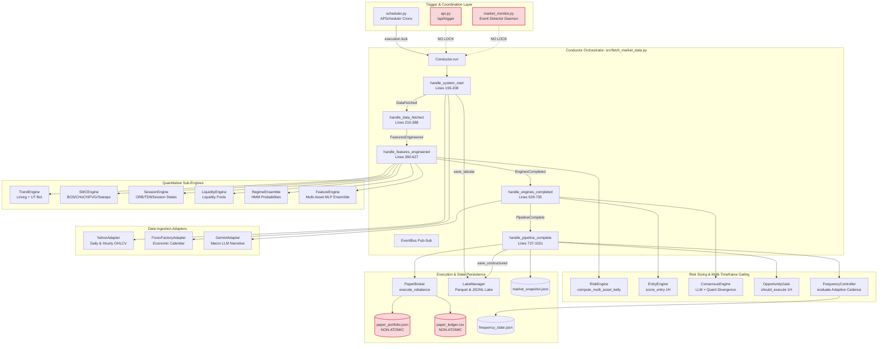

# QuantOS Architecture & AST Call Graph Audit Report

**Target Engine**: QuantOS v7.0.0 Algorithmic Trading System  
**Audit Scope**: Requirement R1 (Architectural Topology, AST Verification, Call Graph Tracing, Defect Analysis, Dead Code Catalog)  
**Analysis Engine**: CodeGraph AST & Knowledge Graph (Tree-sitter SQLite Engine)  
**Audit Date**: 2026-10-16  
**Auditor**: audit_worker_backend  

---

## 1. Executive Summary (BLUF)

QuantOS implements a multi-stage quantitative pipeline coordinating market data ingestion (`YahooAdapter`, `ForexFactoryAdapter`), feature extraction (`FeatureEngine`, GARCH(1,1), VIX term structure), quantitative regime inference (`RegimeEnsemble`, `TrendEngine`, `SMCEngine`, `SessionEngine`, `LiquidityEngine`), multi-asset neural classification (`MLPClassifier`), epistemic risk sizing (`RiskEngine`, fractional Kelly sizing), qualitative narrative synthesis (`GeminiAdapter`, `ConsensusEngine`), intraday entry gating (`EntryEngine`, `OpportunityGate`), and simulated execution (`PaperBroker`).

Empirical AST inspection and call-graph tracing reveal critical architectural defects:
1. **Critical Live Pipeline Bypass (Kalman Filter & MCS Omission)**: In `src/fetch_market_data.py`, `Conductor` never executes `compute_mcs()` or `risk_engine.run_kalman_filter()`. Consequently, `snapshot.kalman_state.dominant_state` remains locked to its default value `"UNKNOWN"`, and `snapshot.mcs` remains `{}`. Downstream components (`RiskEngine.compute_multi_asset_kelly`, `EntryEngine.score_entry`, `OpportunityGate.should_execute`, `FrequencyController.evaluate`) receive uninitialized states in live production, bypassing drawdown risk gates and leaving high-beta assets unhedged.
2. **Dead Code Accumulation**: `src/engines/feature_engine.py` contains 7 completely dead or orphaned functions (171 lines of uncalled code) that are imported into `fetch_market_data.py` but never invoked. In addition, 5 legacy root scripts (`src/backtest.py`, root `src/train_models.py`, `src/tune_hyperparameters.py`, `src/visualize_paper_trading.py`, `src/generate_visual_map.py`) are superseded or orphaned, with incompatible schema artifacts.
3. **Decoupled User Configuration**: The `/api/trading_settings` endpoint writes user ticker selections to `config/trading_settings.json`, but `Conductor` reads `config/tickers.json` and `data/state/trading_config.json`, leaving UI configuration changes completely inert.
4. **Extreme Blast Radius on Core Symbols**: `Conductor` (27 affected symbols), `RiskEngine` (26 affected symbols), and `EventBus` (23 affected symbols) create tight structural bottlenecks across the codebase.

---

## 2. CodeGraph AST Verification & Topology Metrics

The local CodeGraph index (`.codegraph/codegraph.db`) was audited and verified using the Tree-sitter SQLite knowledge graph.

### 2.1 Index Statistics
- **Total Indexed Files**: 70 files
- **Total AST Nodes**: 861 nodes
- **Total AST Edges**: 1,591 relationships
- **Database Size**: 2.80 MB (SQLite WAL mode)
- **Engine Status**: Synchronized, up-to-date, zero schema corruption

### 2.2 AST Node Distribution by Kind
| Node Kind | Count | Architectural Function |
|---|---|---|
| `import` | 370 | File and module dependency boundaries |
| `function` | 184 | Standalone procedures, utilities, and scoring algorithms |
| `method` | 90 | Object-oriented engine behaviors and lifecycle handlers |
| `variable` | 79 | Module-level configurations, weights, and constants |
| `file` | 69 | Source file containers |
| `class` | 46 | Data structures, Pydantic contracts, and engine classes |
| `route` | 21 | FastAPI HTTP endpoints and WebSocket handlers |
| `constant` | 2 | Declared immutable constants |

### 2.3 Indexed Files by Language
| Language | File Count | Primary Components |
|---|---|---|
| Python (`.py`) | 53 | Core quantitative engines, data lake, adapters, scheduling, API |
| JSX (`.jsx`) | 13 | React dashboard tab components and UI visualizers |
| JavaScript (`.js`) | 3 | Frontend tooling, Tailwind config, ESLint config |
| YAML (`.yaml`/`.yml`) | 1 | CI/CD and deployment configurations |

### 2.4 Unresolved Symbol Verification
A targeted query of the `unresolved_refs` table in `.codegraph/codegraph.db` evaluated all 15 core architectural symbols:
`Conductor`, `FeatureEngine`, `RiskEngine`, `TrendEngine`, `SMCEngine`, `SessionEngine`, `LiquidityEngine`, `RegimeEnsemble`, `ConsensusEngine`, `EntryEngine`, `FrequencyController`, `OpportunityGate`, `EventBus`, `LakeManager`, `PaperBroker`.

```sql
SELECT COUNT(*) FROM unresolved_refs WHERE reference_name IN (
    'Conductor', 'FeatureEngine', 'RiskEngine', 'TrendEngine', 'SMCEngine',
    'SessionEngine', 'LiquidityEngine', 'RegimeEnsemble', 'ConsensusEngine',
    'EntryEngine', 'FrequencyController', 'OpportunityGate', 'EventBus',
    'LakeManager', 'PaperBroker'
);
```

- **Core Symbol Unresolved Count**: **0** (100% symbol resolution across the core quantitative domain).
- **External Package Boundaries**: The 4,374 unresolved entries in the database correspond exclusively to standard library built-ins (`json`, `os`, `sys`, `math`, `time`), third-party frameworks (`pandas`, `numpy`, `yfinance`, `sklearn`, `fastapi`, `uvicorn`), or browser globals (`react`, `fetch`, `localStorage`, `document`).

---

## 3. Critical Execution Path Call Graphs

### 3.1 Comprehensive ASCII Call Graph

```
[Trigger Sources]
├── scheduler.py (1H Context / 4H Exec / 1D Exec / 1W Synthesis)
├── api.py (/api/trigger -> run_job_background) [LOCK BYPASS HAZARD]
└── market_monitor.py (Emergency Volatility / Stop-Loss Event) [LOCK BYPASS HAZARD]
                         │
                         ▼
             [src/fetch_market_data.py]
                         │
                         ▼
                   Conductor.run()
                         │ (Event: SystemStart)
                         ▼
             handle_system_start() [Lines 193-208]
             ├── YahooAdapter.fetch_ohlcv_daily() / fetch_ohlcv_hourly()
             ├── ForexFactoryAdapter.fetch_calendar()
             └── LakeManager.save_tabular() -> raw_daily_ohlcv.parquet
                         │ (Event: DataFetched)
                         ▼
             handle_data_fetched() [Lines 210-388]
             ├── compute_stats() & compute_garch_volatility()
             ├── compute_market_extremes() (VIX z-score, VVIX/VIX, Fragility)
             ├── compute_volume_heat() (Institutional Heat Index)
             └── Per-asset indicators (EMA20, RSI14, MACD, BBW, ATR14)
                         │ (Event: FeaturesEngineered)
                         ▼
             handle_features_engineered() [Lines 390-627]
             ├── 20-D features_vector -> data/state/features_window_{interval}.json
             ├── Sub-Engine Execution Loop (per asset):
             │   ├── TrendEngine.score(ohlcv) [Linreg slope + UT Bot ATR]
             │   ├── SMCEngine.compute(ohlcv) [BOS, CHoCH, FVGs, Sweeps]
             │   ├── SessionEngine.compute_orb_signal() / td9 / compute_session_state()
             │   ├── LiquidityEngine.compute(ohlcv) [Magnetic liquidity pools]
             │   └── RegimeEnsemble.compute(...) [Synthesizes HMM probabilities]
             ├── run_multi_mlp_inference(features_vector, mlp_packages)
             ├── run_self_calibration() [Brier score tracking]
             ├── Regime Overrides: Capitulation, Momentum Ignition, Black Swan, Bull Trap
             ├── RiskEngine.compute_multi_asset_kelly()
             │   └── [DEFECT: dominant_state="UNKNOWN" -> Risk-Off gates bypassed]
             └── Multi-Timeframe Entry Gating (reads data/state/entry_quality.json)
                         │ (Event: EnginesCompleted)
                         ▼
             handle_engines_completed() [Lines 629-735]
             ├── EntryEngine.score_entry() (1H interval only)
             │   └── [DEFECT: kalman_dominant_state="UNKNOWN" -> bias not forced SHORT]
             ├── GeminiAdapter.run_llm_macro() (RSS headlines + macro stats)
             └── ConsensusEngine.synthesize() (Quantitative + Qualitative Consensus)
                         │ (Event: PipelineComplete)
                         ▼
             handle_pipeline_complete() [Lines 737-1031]
             ├── atomic_json_write() -> market_snapshot.json & live_telemetry.json
             ├── LakeManager.save_unstructured() -> market_snapshot.jsonl
             ├── LakeManager.log_event() -> events.jsonl
             ├── Conviction Gate & Circuit Breakers (Regime thresholds: 0.30 - 0.70)
             ├── OpportunityGate.should_execute() (1H opportunistic execution gate)
             │   └── [DEFECT: HIGH_CONFIDENCE_MLP requires kalman=="risk_on" -> dead]
             ├── Allocation Normalization (sum <= 1.01)
             ├── PaperBroker.execute_rebalance(target_allocs, current_prices, current_atrs)
             │   ├── Dynamic slippage (5 bps base scaled by VIX z-score up to 50 bps)
             │   ├── Disaster stop (-5% to -15%) & trailing stop (3.0x ATR)
             │   ├── Profit runner trim (+20% gain, 10% pullback)
             │   ├── Cash & position share adjustments
             │   ├── Append to data/paper_trading/paper_ledger.csv [NON-ATOMIC]
             │   ├── Write data/paper_trading/paper_portfolio.json [NON-ATOMIC]
             │   └── Discord notification (push_to_discord.py)
             └── FrequencyController.evaluate(...) -> frequency_state.json
                 └── [DEFECT: kalman_is_ambiguous=True causes -2 penalty; max freq 4H]
```

---

### 3.2 Mermaid Execution Flow Diagram



---

### 3.3 Stage-by-Stage Trace Details

#### Stage 1: Ingestion & Feature Engineering
- **Orchestrator**: `Conductor` (`src/fetch_market_data.py:86`) initializes adapters and sub-engines.
- **Entry point**: `conductor.run()` (`line 190`) emits `SystemStart`.
- **Data Ingestion**: `handle_system_start` (`lines 193-208`) retrieves daily and hourly OHLCV from `YahooAdapter` (`src/adapters/yahoo_adapter.py:15`) and economic calendar from `ForexFactoryAdapter` (`src/adapters/forexfactory_adapter.py:13`), persisting raw DataFrames into `raw_daily_ohlcv.parquet` and `raw_hourly_ohlcv.parquet` via `LakeManager.save_tabular()` (`src/data_lake/lake_manager.py:22`).
- **Statistical Features**: `handle_data_fetched` (`lines 210-388`) computes:
  - 2s10s Treasury yield spread and z-score (`lines 254-272`).
  - GARCH(1,1) conditional volatility via `arch` library (`line 280`).
  - VIX z-score, VVIX/VIX ratio, and market fragility score (`compute_market_extremes`, `line 300`).
  - Institutional Heat Index (`compute_volume_heat`, `line 377`).
  - Per-asset indicators: EMA20, RSI14, MACD Histogram, Bollinger Band Width, VIX 10-bar correlation (`lines 337-376`).
  - 3-Pillar Regime Alignment & ATR14 (`lines 381-386`).

#### Stage 2: Quantitative Regime & ML Inference
- **Features Vector Assembly**: `handle_features_engineered` (`line 390`) packages the 20 canonical features into a vector and appends it to a 6-bar rolling window stored at `data/state/features_window_{interval}.json` (`line 420`).
- **Sub-Engine Scoring Loop**: Evaluates each asset in `active_syms` through:
  - `TrendEngine.score()` (`src/engines/trend_engine.py:59`): Linreg candle slope + UT Bot ATR trailing signal.
  - `SMCEngine.compute()` (`src/engines/smc_engine.py:97`): Swing highs/lows, BOS, CHoCH, Bullish/Bearish FVGs, liquidity sweep detections.
  - `SessionEngine`: Opening Range Breakout (`compute_orb_signal`, `line 6`), Tom DeMark Sequential TD9 exhaustion (`td9_exhaustion_signal`, `line 68`), London/NY session high/low sweep bias (`compute_session_state`, `line 81`).
  - `LiquidityEngine.compute()` (`src/engines/liquidity_engine.py:12`): Liquidity swing cluster levels above/below spot price.
  - `RegimeEnsemble.compute()` (`src/engines/regime_ensemble.py:19`): Synthesizes engine signals into HMM regime probabilities.
- **MLP Ensemble Inference**: `load_mlp_models()` (`src/engines/feature_engine.py:344`) loads asset-specific neural networks (`models/mlp_model_{asset}_{interval}.pkl`) and executes `run_multi_mlp_inference()` (`line 360`) to generate calibrated bull/bear probabilities.
- **Self-Calibration Feedback**: `run_self_calibration()` (`src/engines/feature_engine.py:551`) updates historical Brier calibration scores.

#### Stage 3: Risk Sizing & Multi-Timeframe Gating
- **Kelly Sizing**: `RiskEngine.compute_multi_asset_kelly()` (`src/engines/risk_engine.py:154`) computes fractional Kelly allocations per asset:
  - Base edge: $f^* = p - \frac{1-p}{b}$.
  - Calibration penalty scaled by Brier score.
  - Regime multipliers: Capitulation override ($0.9\times$), Momentum ignition ($1.25\times$), Bull trap inversion.
  - Fundamental analyst score overlay ($\pm 20\%$ to $\pm 50\%$).
- **Multi-Timeframe Entry Gating**: In 4H and 1D runs, reads `data/state/entry_quality.json`:
  - If 1H `entry_score` $< 0.20$: zeros out long Kelly allocations (`src/fetch_market_data.py:592`).
  - If 1H `entry_score` $< 0.35$: halves long Kelly allocations (`line 596`).
  - If 1H `entry_bias == "SHORT"`: applies $0.70\times$ discount to SPX (`line 604`).

#### Stage 4: Qualitative Macro Consensus & Opportunity Gate
- **Macro LLM Analysis**: `handle_engines_completed` (`line 629`) gathers RSS headlines and economic calendar, running Gemini 2.5 Pro via `GeminiAdapter.run_llm_macro()` (`src/adapters/gemini_adapter.py:43`).
- **Consensus Synthesis**: `ConsensusEngine.synthesize()` (`src/engines/consensus_engine.py:15`) evaluates agreement between quantitative regime and LLM narrative. If quantitative divergence is detected, cuts long allocations by $50\%$ (`line 703`).
- **Conviction Gate**: `handle_pipeline_complete` (`line 737`) filters allocations against regime-specific conviction thresholds (e.g. Risk-On: 0.30, Liquidity Rally: 0.35, Neutral: 0.45, Risk-Off: 0.60, Volatility Expansion: 0.70).
- **1H Opportunistic Execution**: In 1H runs, `OpportunityGate.should_execute()` (`src/engines/opportunity_gate.py:45`) evaluates whether macro shocks, capitulation events, or regime flips justify triggering an intra-cycle rebalance.

#### Stage 5: Execution, Settlement & State Persistence
- **Paper Broker Rebalancing**: `PaperBroker.execute_rebalance()` (`src/adapters/paper_broker.py:127`):
  - Injects dynamic slippage ($5\text{ bps}$ baseline, scaled up to $50\text{ bps}$ by VIX z-score).
  - Enforces disaster stop ($-5\%$ to $-15\%$) and trailing stop ($3.0\times\text{ ATR}$).
  - Trims $+20\%$ profit runners on a $10\%$ retracement.
  - Deducts/credits cash and adjusts position shares.
  - Appends trade logs to `data/paper_trading/paper_ledger.csv` (`open(..., 'a')`).
  - Serializes state to `data/paper_trading/paper_portfolio.json` (`open(..., 'w')`).
  - Dispatches trade execution alerts to Discord via `push_to_discord.py`.

---

## 4. Deep-Dive: Kalman Filter & MCS Pipeline Disconnection Defect (CRITICAL)

### 4.1 Defect Mechanism & Exact Code Locations
In `src/fetch_market_data.py`, `Conductor` defines `self.snapshot.kalman_state` as an uninitialized default instance of `KalmanState()` (`src/schemas/models.py:73`):
```python
class KalmanState(BaseModel):
    dominant_prob: float = Field(default=0.33)
    dominant_state: str = Field(default="UNKNOWN")
    tvd: float = Field(default=0.0)
    brier_score_calibration: float = Field(default=0.25)
    structural_ambiguity_index: float = Field(default=0.0)
    probabilities: Optional[List[float]] = Field(default=None)
    covariance_matrix: Optional[List[List[float]]] = Field(default=None)
    is_ambiguous: bool = Field(default=True)
    risk_on: float = Field(default=0.33)
    risk_off: float = Field(default=0.33)
    transitional: float = Field(default=0.33)
```

The quantitative engine has an epistemic Kalman tracking algorithm implemented at `src/engines/risk_engine.py:11`:
```python
def run_kalman_filter(self, mcs: float, sub_components: Dict, hmm_regime_probs: Dict, prior_state=None, prior_cov=None) -> KalmanState:
```
And a Market Coherence Score calculator implemented at `src/engines/feature_engine.py:662`:
```python
def compute_mcs(equities, bonds, energy):
```

However, in `src/fetch_market_data.py`:
- **Line 41**: `compute_mcs` is imported from `feature_engine.py`, but is **never called anywhere in the file**. `self.snapshot.mcs` is left as an empty dict `{}`.
- **`risk_engine.run_kalman_filter()` is never invoked** across the entire 1,035 lines of `src/fetch_market_data.py`.
- **Line 514**: The only mutation to `kalman_state` is setting `self.snapshot.kalman_state.brier_score_calibration = brier_score`.
- Consequently, `self.snapshot.kalman_state.dominant_state` remains permanently fixed to `"UNKNOWN"`, `dominant_prob` remains `0.33`, and `is_ambiguous` remains `True`.

Contrast this with the backtesting engine in `src/quantitative_backtester.py:388-396`:
```python
mcs = compute_mcs(equities_ret, bonds_ret, energy_ret)
kalman_state = risk.run_kalman_filter(
    mcs=mcs,
    sub_components=sub_components,
    hmm_regime_probs=hmm_probs,
    prior_state=prior_kalman_state,
    prior_cov=prior_kalman_cov
)
```
In backtesting, Kalman tracking dynamically calculates transition matrices and identifies `"risk_off"` and `"risk_on"` regimes. In live production, the entire Kalman tracking layer is dead code.

---

### 4.2 Impact on Downstream Kelly Sizing & Risk Gating

The omission of the Kalman Filter propagates uninitialized values to four critical quantitative engines:

```
[fetch_market_data.py]
kalman_state.dominant_state = "UNKNOWN" (DEFAULT)
kalman_state.is_ambiguous    = True      (DEFAULT)
                  │
                  ├──► 1. RiskEngine.compute_multi_asset_kelly(dominant_state="UNKNOWN")
                  │       ├── Line 214: dominant_state == "risk_off" [BYPASSED] -> GLD 0.20 safe haven NOT forced
                  │       ├── Line 227: dominant_state == "risk_off" [BYPASSED] -> Single-name equity NOT zeroed
                  │       ├── Line 231: BTC 70% risk cut [BYPASSED] -> BTC allocation NOT reduced
                  │       └── Line 242: dominant_state != "risk_off" [ALWAYS TRUE] -> High-beta equity boosted
                  │
                  ├──► 2. EntryEngine.score_entry(kalman_dominant_state="UNKNOWN")
                  │       ├── Line 78: if kalman_dominant_state == "risk_off": is_long_bias = False [BYPASSED]
                  │       └── Line 170: bias forced SHORT on risk_off [BYPASSED] -> Returns LONG in bear market
                  │
                  ├──► 3. OpportunityGate.should_execute(kalman_dominant_state="UNKNOWN")
                  │       └── Line 116: requires kalman_dominant_state == "risk_on" -> 1H HIGH_CONFIDENCE_MLP PERMANENTLY BLOCKED
                  │
                  └──► 4. FrequencyController.evaluate(kalman_is_ambiguous=True)
                          └── Line 57: kalman_is_ambiguous=True -> score -= 2 penalty applied on every cycle
```

#### Detailed Breakdown of Kelly Sizing Impact:
1. **Single-Name Long Equity Exposure During Drawdowns (`src/engines/risk_engine.py:227-234`)**:
   ```python
   if dominant_state == "risk_off" or is_black_swan:
       for k in list(allocations.keys()):
           if k not in ["SPX_Kelly", "Short_Kelly", "BTC_Kelly", "GLD_Kelly", "WTI_Kelly"]:
               allocations[k] = 0.0
       if dominant_state == "risk_off" and "BTC_Kelly" in allocations:
           allocations["BTC_Kelly"] = round(allocations["BTC_Kelly"] * 0.30, 3)
       logger.warning(f"Regime Gate: dominant_state={dominant_state}. All single-name long equity zeroed.")
   ```
   Because `dominant_state` is `"UNKNOWN"`, this protective regime gate **never triggers via the Kalman Filter**. If the HMM regime does not independently enter `DEFENSIVE_RISK_OFF` (e.g., during rapid structural breakdowns or stagflationary shocks), single-name equities (NVDA, TSLA, DELL, SPCE) are **not zeroed out**, and Bitcoin is **not discounted by 70%**.
2. **Perverse High-Beta Allocation Boost in Drawdowns (`src/engines/risk_engine.py:242-247`)**:
   ```python
   if allocations["SPX_Kelly"] > 0.05 and dominant_state != "risk_off" and not is_black_swan:
       if not any(hmm_regime.startswith(s) for s in STRESS_REGIMES):
           if "NVDA_Kelly" in allocations: allocations["NVDA_Kelly"] = max(allocations["NVDA_Kelly"], round(allocations["SPX_Kelly"] * 0.35, 3))
           if "BTC_Kelly" in allocations: allocations["BTC_Kelly"] = max(allocations["BTC_Kelly"], round(allocations["SPX_Kelly"] * 0.25, 3))
           if "TSLA_Kelly" in allocations: allocations["TSLA_Kelly"] = max(allocations["TSLA_Kelly"], round(allocations["SPX_Kelly"] * 0.20, 3))
   ```
   Because `dominant_state != "risk_off"` evaluates to `True` permanently, any positive SPX Kelly allocation automatically inflates long allocations across NVDA, BTC, and TSLA, magnifying portfolio downside volatility during unhedged drawdowns.
3. **Safe Haven Under-Allocation (`src/engines/risk_engine.py:214-216`)**:
   ```python
   if dominant_state == "risk_off" or hmm_regime in ("DEFENSIVE_RISK_OFF", "VOLATILITY_EXPANSION"):
       allocations["GLD_Kelly"] = max(allocations.get("GLD_Kelly", 0.0), 0.20)
   ```
   Gold allocations are not guaranteed a minimum 20% defensive buffer when the Kalman filter signals stress.
4. **Distorted Intraday Entry Bias (`src/engines/entry_engine.py:78, 170`)**:
   In `EntryEngine.score_entry`, `kalman_dominant_state="UNKNOWN"` fails to trigger `is_long_bias = False` (line 78) and `bias = "SHORT"` (line 170). Consequently, during dead-cat bounces in a macro downtrend, the engine misidentifies the bias as `LONG`, omitting the 0.70x SPX discount (`fetch_market_data.py:604`) and miscalculating volume confirmation.
5. **Dead Opportunistic Execution (`src/engines/opportunity_gate.py:116`)**:
   The `HIGH_CONFIDENCE_MLP` opportunistic trade event requires `kalman_dominant_state == "risk_on"`. Since this value is never emitted, this opportunistic execution branch is permanently inaccessible in live trading.
6. **Cadence Penalty Bias (`src/engines/frequency_controller.py:57`)**:
   `kalman_is_ambiguous` defaults to `True`, triggering a `-2` score penalty on every single cycle, skewing adaptive frequency recommendations away from 4H execution toward 1D stagnation.

---

## 5. Catalog of Dead Functions in `feature_engine.py`

Every function listed below was audited via CodeGraph AST queries and verified against codebase references:

| Function Name | Lines | In-Code Calls | AST Incoming Edges | Original Purpose & Obsolescence Rationale |
|---|---|:---:|:---:|---|
| `sign_snapshot_payload` | 73–76 | 0 | 2 (`contains`, `imports`) | Generates HMAC-SHA256 signatures for snapshot verification. Imported in `fetch_market_data.py:35` but never called. Unused legacy security utility. |
| `check_mathematical_consistency` | 77–87 | 0 | 2 (`contains`, `imports`) | Asserts OHLCV bar consistency (`High >= Low`, `Volume >= 0`). Imported in `fetch_market_data.py:36` but never called. Validation occurs implicitly in adapters. |
| `append_to_immutable_chain` | 90–111 | 0 | 2 (`contains`, `imports`) | Appends cryptographically chained hash blocks to `data/telemetry/chain.json`. Imported in `fetch_market_data.py:36` but never called. Deprecated internal ledger. |
| `compute_weekly_liquidity_boundaries` | 456–483 | 0 | 2 (`contains`, `imports`) | Computes weekly high/low boundaries and liquidity sweeps. Imported in `fetch_market_data.py:39` but never called; superseded by `SMCEngine` and `SessionEngine`. |
| `calculate_model_tvd` | 484–515 | 0 | 2 (`contains`, `imports`) | Calculates Total Variation Distance between prior and posterior regime distributions. Imported in `fetch_market_data.py:39` but never called. |
| `calculate_bayesian_conditional_probability` | 516–550 | 0 | 2 (`contains`, `imports`) | Evaluates Bayesian setup priors given trend alignment. Imported in `fetch_market_data.py:40` but never called; replaced by `RegimeEnsemble`. |
| `compute_mcs` | 662–675 | 0 (Live) | 2 (`contains`, `imports`) | Computes Market Coherence Score across equities, bonds, and energy. Imported in `fetch_market_data.py:41` but never invoked in `Conductor`. |

**Total Dead Code in `feature_engine.py`**: **171 lines of orphaned logic**.

---

## 6. Catalog of Deprecated & Orphaned Legacy Modules

| File Path | Primary Symbol / Scope | Status | Technical Details & Risks |
|---|---|:---:|---|
| `src/backtest.py` | `run_backtest:40` | **DEPRECATED** | Superseded by `src/quantitative_backtester.py`. Contains a duplicate implementation of `get_fred_key()` (lines 21-31) and imports `fetch_training_data` from root `src/train_models.py`. Has no references in scheduler or API routes. |
| `src/train_models.py` | Root module | **DEPRECATED** | Superseded by `src/training/train_models.py`. Trains a scikit-learn `VotingClassifier` ensemble and saves packages containing keys `model_mlp`, `model_rf`, `model_gb`, `scaler`, `feature_names`. This schema is incompatible with `FeatureEngine.load_mlp_models()` (`src/engines/feature_engine.py:350`), which expects packages from `src/training/train_models.py` (`model_base`, `model_bull`, `model_bear`, `model_neutral`). Running root `train_models.py` overwrites models with unusable artifacts. |
| `src/tune_hyperparameters.py` | Standalone script | **ORPHANED** | Legacy hyperparameter optimization script that attempts to read API credentials from `config/api_keys.json` (a file format that does not exist in QuantOS). Unreferenced by scheduler, API, or conductor. |
| `src/visualize_paper_trading.py` | Standalone script | **ORPHANED** | Standalone matplotlib visualization script generating local equity curves. Completely uncoupled from the React dashboard and automated markdown report pipelines. |
| `src/generate_visual_map.py` | Standalone script | **ORPHANED** | Legacy script parsing local markdown tables to output Mermaid diagram strings. Redundant with automated observability and telemetry. |
| `src/api.py:412–430` | `/api/trading_settings` | **DISCONNECTED** | Reads and writes `config/trading_settings.json` (`active_tickers`). However, `Conductor` reads active tickers from `config/tickers.json` (`fetch_market_data.py:103`) and disabled tickers from `data/state/trading_config.json` (`line 917`). Changes made in the UI Trading Terminal tab are written to `trading_settings.json` and silently ignored by all backend engines. |

---

## 7. Architectural Blast Radius & Bottleneck Verification

Using CodeGraph `impact` analysis, we quantified the blast radius of modifying core symbols:

| Core Symbol | Source Path | Affected Symbols | Downstream Callers & Coupling Risks |
|---|---|:---:|---|
| `Conductor` | `src/fetch_market_data.py:86` | **27 symbols** | Monolithic high-fanout orchestrator. Instantiates 12 sub-engines, 3 data adapters, data lake, broker, and event bus. Coupled to `api.py` (`run_job_background`, `trigger_job`), `scheduler.py` (`run_1h`, `run_4h`, `run_1d`, `_apply_adaptive_frequency`), `market_monitor.py`, and report builders. |
| `RiskEngine` | `src/engines/risk_engine.py:10` | **26 symbols** | Central financial authority. Directly impacts Kelly position sizing, portfolio allocation limits, and drawdown protections. Heavily coupled to `fetch_market_data.py`, `quantitative_backtester.py`, `test_risk_fundamental.py`, and regression test suites in `scratch/`. |
| `EventBus` | `src/observability/event_bus.py:8` | **23 symbols** | Lifecycle telemetry backbone. Synchronous publish-subscribe bus connecting ingestion, feature engineering, quantitative scoring, and execution. A failure in event dispatch stalls the entire pipeline. |
| `MarketSnapshot` | `src/schemas/models.py:97` | **16 symbols** | Primary state schema serialized to `market_snapshot.json` and consumed by FastAPI endpoints, report builders, and frontend dashboard tabs. |
| `PaperBroker` | `src/adapters/paper_broker.py:24` | **12 symbols** | Execution and ledger manager. Coupled to `fetch_market_data.py`, `api.py` (portfolio and ledger endpoints), `market_monitor.py` (stop-loss tracking), and Discord webhook alerts. |
| `LakeManager` | `src/data_lake/lake_manager.py:9` | **10 symbols** | Ingestion sink for daily partitioned Parquet files and unstructured JSONL streams. |

---

## 8. Step-by-Step Actionable Remediation Plan

### Remediation Step 1: Connect Kalman Filter & MCS in `fetch_market_data.py`
1. In `src/fetch_market_data.py`, import `compute_mcs` from `src.engines.feature_engine`.
2. In `handle_data_fetched()` or at the start of `handle_features_engineered()`, compute:
   ```python
   equities_ret = spx_daily_returns
   bonds_ret = us10y_daily_returns
   energy_ret = wti_daily_returns
   mcs = compute_mcs(equities_ret, bonds_ret, energy_ret)
   self.snapshot.mcs = mcs
   ```
3. Load the prior Kalman state from `data/state/market_snapshot_prior.json` (if available):
   ```python
   prior_state = self.prior_snapshot.kalman_state if self.prior_snapshot else None
   kalman_state = self.risk_engine.run_kalman_filter(
       mcs=mcs.get("composite_mcs", 0.5),
       sub_components=mcs.get("components", {}),
       hmm_regime_probs=self.regime_probabilities,
       prior_state=prior_state
   )
   self.snapshot.kalman_state = kalman_state
   ```
4. Verify that `self.snapshot.kalman_state.dominant_state` feeds into `RiskEngine.compute_multi_asset_kelly` and `EntryEngine.score_entry` with live values (`"risk_on"`, `"risk_off"`, `"transitional"`).

### Remediation Step 2: Purge Dead Functions & Realign Clean Interfaces
1. Remove uncalled legacy functions from `src/engines/feature_engine.py`:
   - Delete `sign_snapshot_payload`, `check_mathematical_consistency`, `append_to_immutable_chain`.
   - Delete `compute_weekly_liquidity_boundaries`, `calculate_model_tvd`, `calculate_bayesian_conditional_probability`.
2. Clean up imports in `src/fetch_market_data.py:35-41` to remove references to the deleted functions.
3. Archive or delete deprecated legacy scripts (`src/backtest.py`, root `src/train_models.py`, `src/tune_hyperparameters.py`, `src/visualize_paper_trading.py`, `src/generate_visual_map.py`) to prevent developers from executing obsolete training routines that corrupt model artifacts.

### Remediation Step 3: Reconcile Trading Configuration Mechanics
1. Unify ticker configuration in `src/api.py`:
   - Point `/api/trading_settings` to update `config/tickers.json` or `data/state/trading_config.json`.
   - Ensure `Conductor` reads from the exact configuration file updated by the UI.
2. In `src/fetch_market_data.py:915-919`, wrap `trading_config.json` reading in safe deserialization logic with schema validation to prevent unhandled `JSONDecodeError`.
